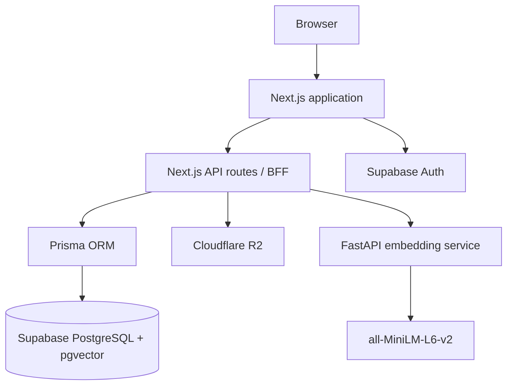

# LifeFlow

**A personal productivity platform that brings tasks, goals, journaling, documents, and AI-powered insights together in one application.**

LifeFlow helps individuals organize their work and personal priorities, understand their productivity patterns, and turn long-term goals into manageable actions.

- **Repository:** https://github.com/kathimba/LifeFlow
- **Production application:** https://life-flow-beryl.vercel.app/login

## Features

### Core productivity
- **Tasks:** Create, prioritize, and track tasks with due dates and recurrence.
- **Goals:** Organize goals and sub-goals, with progress roll-up.
- **Journal:** Record daily entries, mood, and energy; monitor journaling streaks.
- **Dashboard:** See today's focus, quick-capture actions, and recommendations.
- **Documents:** Store files in Cloudflare R2 and associate them with goals and tasks.

### Productivity tools
- **Reminders:** Task-linked reminders and in-app notifications.
- **Full-text search:** Search across application data using PostgreSQL full-text search.
- **Preset tasks:** Ready-to-use task ideas across multiple categories.
- **Recurring tasks:** Generate the next task instance when a recurring task is completed.

### AI and insights
- **Analytics:** Weekly score, task flow, goal trends, and peak productivity hours.
- **Recommendations:** Daily focus, next-best-task suggestions, and goal nudges.
- **Semantic search:** Embedding-based search backed by pgvector.
- **Embeddings:** A separate Python service uses `all-MiniLM-L6-v2` to generate text embeddings.
- **PDF text extraction:** The embedding service exposes an endpoint for extracting text from PDF files.

## Architecture



| Layer | Technology |
|---|---|
| Frontend and application API | Next.js 16, React, TypeScript |
| UI | Tailwind CSS, shadcn/ui, Radix UI |
| Backend application pattern | Next.js API routes (BFF) |
| ORM | Prisma 5 |
| Database | Supabase-hosted PostgreSQL with pgvector |
| Authentication | Supabase Auth |
| Object storage | Cloudflare R2 |
| Embedding service | Python, FastAPI, sentence-transformers |
| Embedding model | `all-MiniLM-L6-v2` |
| Frontend hosting | Vercel |
| Embedding-service hosting | Fly.io |

The main application backend is implemented through Next.js API routes. FastAPI is a separate service used for embedding generation and PDF text extraction; it is not a second general-purpose application API.

## Repository structure

```text
LifeFlow/
├── frontend/
│   ├── prisma/
│   │   └── schema.prisma
│   ├── src/
│   │   ├── app/              # Pages and API routes
│   │   ├── components/       # Reusable UI components
│   │   └── lib/              # Services, auth helpers, utilities
│   ├── package.json
│   └── .env.local            # Local secrets; do not commit
│
├── backend/
│   ├── embedding_service.py  # FastAPI embedding/PDF service
│   └── requirements.txt
│
├── README.md
└── DEVELOPMENT.md
```

## Getting started

For the full setup—including environment variables, database safety, and running both services—see **[DEVELOPMENT.md](./DEVELOPMENT.md)**.

### Prerequisites

- Node.js 20.9 or newer (Node.js 22 LTS recommended)
- npm
- Python 3.10 or newer (Python 3.11 recommended)
- A Supabase project with the required PostgreSQL schema and pgvector extension
- A Cloudflare R2 bucket
- Access to the LifeFlow FastAPI embedding service, or the ability to run it locally

### Quick start

```bash
git clone https://github.com/kathimba/LifeFlow.git
cd LifeFlow

# Configure frontend environment variables first.
cp frontend/.env.example frontend/.env.local
```

Edit `frontend/.env.local` with your own development credentials, then:

```bash
cd frontend
npm install
npx prisma generate
npm run dev
```

The frontend is available at http://localhost:3000.

To run the embedding service locally, open another terminal:

```bash
cd LifeFlow/backend
python3 -m venv .venv
source .venv/bin/activate
pip install -r requirements.txt
pip install pypdf
python embedding_service.py
```

The embedding service listens on http://localhost:8000. The `pypdf` installation is needed by the `/extract-text` endpoint; ensure it is added to the project's dependency file when maintaining the backend.

> **Database safety:** The quick start intentionally does not run `prisma db push`. A fresh clone can connect to the existing Supabase database without changing its schema. Do not run schema-changing commands against production unless you have reviewed the schema change, confirmed the target database, and taken an appropriate backup.

## Environment variables

The frontend reads its environment variables from `frontend/.env.local` during local development. See [`frontend/.env.example`](./frontend/.env.example) for the template.

| Variable | Purpose |
|---|---|
| `DATABASE_URL` | PostgreSQL connection string used by Prisma |
| `NEXT_PUBLIC_SUPABASE_URL` | Supabase project URL |
| `NEXT_PUBLIC_SUPABASE_ANON_KEY` | Supabase anon/public client key |
| `R2_ACCESS_KEY_ID` | Cloudflare R2 access key |
| `R2_SECRET_ACCESS_KEY` | Cloudflare R2 secret key |
| `R2_ENDPOINT` | Cloudflare R2 S3-compatible endpoint |
| `R2_BUCKET_NAME` | R2 bucket name |
| `EMBEDDING_SERVICE_URL` | Base URL of the FastAPI embedding service |

`NODE_ENV` is managed by Next.js and normally does not need to be added to `.env.local`.

The current FastAPI service does not read application-specific environment variables. Its model name and listening port are currently defined in `backend/embedding_service.py`.

**Never commit real `.env` files, database passwords, R2 secrets, or other credentials.** Only commit example files containing empty placeholders.

## Testing and quality checks

The frontend dependencies include Vitest and ESLint. From `frontend/`:

```bash
npx vitest run
npm run lint
npm run build
```

Run tests only after configuring a safe test database and test environment. Do not point tests or schema setup commands at the production database.

## Roadmap

The core productivity, AI/insights, and goal-hierarchy capabilities form the current foundation. Future areas for development include:

- **Collaboration:** Shared goals, task assignment, and comments.
- **Mobile and offline:** Progressive Web App support, offline workflows, and push notifications.
- **Further polish:** OCR, mood/productivity correlation, weekly review emails, data export, and dark mode.

## Contributing

1. Create a feature branch.
2. Make focused changes.
3. Run relevant tests and lint/build checks.
4. Keep secrets out of commits.
5. Open a pull request describing the change and how it was tested.

## License

Add the project's chosen license here. Until a license is added to the repository, do not assume that the source code is available for unrestricted reuse.
